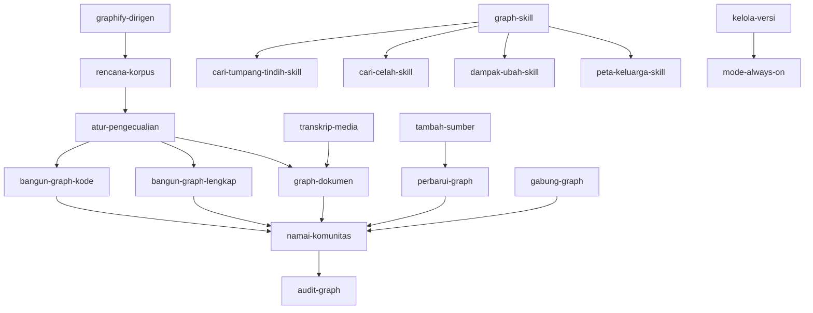

# Arsitektur Keluarga Skill Graphify

Sumber kebenaran: `skill-index.json`. `INDEKS-SKILL.md`, peta di dirigen, dan `PETA-KELUARGA.md`
dibuat otomatis darinya.

## Dasar rancangan

Pemilik repo memilih (2026-11-19): sekitar 30 skill, fokus **operasional graphify** serta **graph
dokumen dan perpustakaan skill**, bentuk keluarga dengan dirigen seperti Studio Wall Art by Nangka,
paket `.skill` untuk claude.ai, dan graph ikut di-commit.

Yang sengaja tidak dibuat: tanya-jawab kode, analisis dampak kode, tinjauan PR, dan navigator per
project. Skill resmi `graphify` tetap menjawab pertanyaan kode lewat `graphify query`, `path`, `explain`.

## Tiga peran

| Peran | Jumlah | Aturan |
|---|---|---|
| Pintu masuk | 1 | `graphify-dirigen`. Mengarahkan; tidak ada skill yang menyerahkan balik kepadanya. |
| Layanan | 6 | pasang-cli, diagnosa-lingkungan, catatan-graph, penjaga-biaya, gerbang-mutu, memori-jawaban. Dipanggil, mengembalikan hasil, tidak memanggil skill jalur. |
| Jalur | 26 | Menerima hasil sebelumnya, menyerahkan ke berikutnya lewat blok SERAH TERIMA. |

Tidak ada ketergantungan melingkar; diperiksa otomatis oleh `tools/run_tests.py`.

## Alur utama

Skill ujung yang dipilih dirigen sesuai kebutuhan: banding-graph, tanya-dokumen, ekspor-pengetahuan,
ekspor-visual, ekspor-database, server-mcp, otomasi-git, atasi-masalah. Layanan dipakai di banyak
tempat dan tidak digambar di sini; diagram lengkap ada di `PETA-KELUARGA.md`.

## Empat gerbang

| Gerbang | Yang dinilai | Bukti utama |
|---|---|---|
| G1 | Rencana korpus | corpus_id, lingkup, lokasi keluaran, data pribadi keluar, izin biaya |
| G2 | Graph sehat | keluaran `audit_graph.py`: tidak kosong, tanpa path sensitif, noise di bawah 5%, tanpa minified |
| G3 | Siap di-commit atau dibagikan | G2, graph segar terhadap HEAD, cache tidak ikut |
| G4 | Ekspor atau integrasi | berkas ada, tanpa kredensial, tujuan luar diizinkan |

Pemilik keputusan: `graphify-gerbang-mutu`. Pengukurnya: `graphify-audit-graph`.

## Keputusan rancangan

| Keputusan | Alasan |
|---|---|
| Wiki dan Obsidian digabung (ekspor-pengetahuan) | Keduanya mengubah graph jadi Markdown dengan pemeriksaan yang sama. |
| Konversi PDF/Office masuk graph-dokumen | Selalu dijalankan sebagai bagian build dokumen. |
| Audit dan gerbang dipisah | Mengukur dan memutuskan adalah dua tanggung jawab. |
| Graph skill dibangun skrip, bukan pass semantik | Skill adalah Markdown; jalur graphify biasa butuh LLM (±132 ribu token) dan menulis ke `graphify-out/` utama. Skrip pasti, gratis, dan hasilnya tetap bisa ditanya CLI graphify. |
| Pelabelan komunitas tanpa backend LLM graphify | Di sesi cloud CLI `claude` menjadi cadangan pelabelan dan memakai token diam-diam. Semua `cluster-only` memakai `--no-label`; nama ditulis model sesi lewat `namai_komunitas.py`. |
| Hook asisten dibungkus `command -v graphify` | Container cloud baru belum punya CLI; tanpa pembungkus setiap Read/Grep/Glob/Bash memunculkan error. |
| Korpus non-utama di `graphify-kerja/graph/<id>/` | Skill resmi menulis ke `./graphify-out/`; menjalankannya dari akar untuk folder lain menimpa graph utama. |
| Semua skill berawalan `graphify-` | Pemicu jelas dan tidak bertabrakan dengan keluarga `studio-`, `etsy-`, `wall-art-`. |

## Temuan saat membangun yang mengubah rancangan

1. `perkiraan_biaya.py` awalnya mencetak daftar path yang diabaikan (bukan jumlahnya) karena `detect()`
   mengembalikan list; diperbaiki dan diuji.
2. Pemeriksa tumpang tindih menemukan 13 pasangan pemicu bentrok di keluarga ini sendiri, termasuk
   "apa langkah berikutnya?" yang sama dengan orkestrator Studio. Sebelas diperbaiki di deskripsi;
   pemeriksa dipertajam agar frasa satu kata tidak dihitung. Sisa satu pasangan dengan batas tertulis.
3. Deskripsi `graphify-mode-always-on` terpotong karena ` #` dibaca YAML sebagai komentar. Diperbaiki,
   dan pemeriksaan ` #` ditambahkan ke uji struktur dan ke pemeriksa celah.
4. `graphify update` memberi nama cadangan dari hub (misalnya "json", "argparse") untuk komunitas yang
   berubah. Skrip penamaan dan audit kini mengenali nama cadangan ini sebagai sementara.
