# Peta keluarga: Keluarga Skill Graphify

33 skill: 1 pintu masuk, 6 layanan, 26 jalur. Panah tegas = menyerahkan ke; panah putus-putus = memakai layanan.

```mermaid
flowchart TD
    subgraph GA["A. Pintu masuk dan fondasi"]
        graphify_dirigen["dirigen"]
        graphify_pasang_cli["pasang-cli"]
        graphify_diagnosa_lingkungan["diagnosa-lingkungan"]
        graphify_catatan_graph["catatan-graph"]
        graphify_penjaga_biaya["penjaga-biaya"]
        graphify_gerbang_mutu["gerbang-mutu"]
    end
    subgraph GB["B. Membangun dan merawat graph"]
        graphify_rencana_korpus["rencana-korpus"]
        graphify_atur_pengecualian["atur-pengecualian"]
        graphify_bangun_graph_kode["bangun-graph-kode"]
        graphify_bangun_graph_lengkap["bangun-graph-lengkap"]
        graphify_namai_komunitas["namai-komunitas"]
        graphify_audit_graph["audit-graph"]
        graphify_perbarui_graph["perbarui-graph"]
        graphify_banding_graph["banding-graph"]
    end
    subgraph GC["C. Graph dokumen dan sumber pengetahuan"]
        graphify_graph_dokumen["graph-dokumen"]
        graphify_tanya_dokumen["tanya-dokumen"]
        graphify_tambah_sumber["tambah-sumber"]
        graphify_transkrip_media["transkrip-media"]
        graphify_ekspor_pengetahuan["ekspor-pengetahuan"]
        graphify_memori_jawaban["memori-jawaban"]
    end
    subgraph GD["D. Graph perpustakaan skill"]
        graphify_graph_skill["graph-skill"]
        graphify_cari_tumpang_tindih_skill["cari-tumpang-tindih-skill"]
        graphify_cari_celah_skill["cari-celah-skill"]
        graphify_dampak_ubah_skill["dampak-ubah-skill"]
        graphify_peta_keluarga_skill["peta-keluarga-skill"]
    end
    subgraph GE["E. Ekspor, integrasi, dan otomasi"]
        graphify_ekspor_visual["ekspor-visual"]
        graphify_ekspor_database["ekspor-database"]
        graphify_server_mcp["server-mcp"]
        graphify_otomasi_git["otomasi-git"]
        graphify_gabung_graph["gabung-graph"]
        graphify_mode_always_on["mode-always-on"]
    end
    subgraph GF["F. Perawatan dan pemecahan masalah"]
        graphify_atasi_masalah["atasi-masalah"]
        graphify_kelola_versi["kelola-versi"]
    end
    graphify_rencana_korpus --> graphify_atur_pengecualian
    graphify_rencana_korpus -.-> graphify_penjaga_biaya
    graphify_rencana_korpus -.-> graphify_catatan_graph
    graphify_rencana_korpus -.-> graphify_gerbang_mutu
    graphify_atur_pengecualian --> graphify_bangun_graph_kode
    graphify_atur_pengecualian --> graphify_bangun_graph_lengkap
    graphify_atur_pengecualian --> graphify_graph_dokumen
    graphify_atur_pengecualian -.-> graphify_pasang_cli
    graphify_bangun_graph_kode --> graphify_namai_komunitas
    graphify_bangun_graph_kode -.-> graphify_pasang_cli
    graphify_bangun_graph_kode -.-> graphify_catatan_graph
    graphify_bangun_graph_lengkap --> graphify_namai_komunitas
    graphify_bangun_graph_lengkap -.-> graphify_pasang_cli
    graphify_bangun_graph_lengkap -.-> graphify_penjaga_biaya
    graphify_bangun_graph_lengkap -.-> graphify_catatan_graph
    graphify_namai_komunitas --> graphify_audit_graph
    graphify_audit_graph -.-> graphify_gerbang_mutu
    graphify_perbarui_graph --> graphify_namai_komunitas
    graphify_perbarui_graph -.-> graphify_pasang_cli
    graphify_perbarui_graph -.-> graphify_catatan_graph
    graphify_graph_dokumen --> graphify_namai_komunitas
    graphify_graph_dokumen -.-> graphify_pasang_cli
    graphify_graph_dokumen -.-> graphify_penjaga_biaya
    graphify_graph_dokumen -.-> graphify_catatan_graph
    graphify_tanya_dokumen -.-> graphify_memori_jawaban
    graphify_tambah_sumber --> graphify_perbarui_graph
    graphify_tambah_sumber -.-> graphify_penjaga_biaya
    graphify_tambah_sumber -.-> graphify_catatan_graph
    graphify_transkrip_media --> graphify_graph_dokumen
    graphify_transkrip_media -.-> graphify_pasang_cli
    graphify_transkrip_media -.-> graphify_penjaga_biaya
    graphify_ekspor_pengetahuan -.-> graphify_pasang_cli
    graphify_graph_skill --> graphify_cari_tumpang_tindih_skill
    graphify_graph_skill --> graphify_cari_celah_skill
    graphify_graph_skill --> graphify_dampak_ubah_skill
    graphify_graph_skill --> graphify_peta_keluarga_skill
    graphify_graph_skill -.-> graphify_pasang_cli
    graphify_graph_skill -.-> graphify_catatan_graph
    graphify_ekspor_visual -.-> graphify_pasang_cli
    graphify_ekspor_database -.-> graphify_pasang_cli
    graphify_ekspor_database -.-> graphify_penjaga_biaya
    graphify_server_mcp -.-> graphify_pasang_cli
    graphify_otomasi_git -.-> graphify_pasang_cli
    graphify_gabung_graph --> graphify_namai_komunitas
    graphify_gabung_graph -.-> graphify_pasang_cli
    graphify_gabung_graph -.-> graphify_catatan_graph
    graphify_mode_always_on -.-> graphify_pasang_cli
    graphify_atasi_masalah -.-> graphify_diagnosa_lingkungan
    graphify_kelola_versi --> graphify_mode_always_on
    graphify_kelola_versi -.-> graphify_pasang_cli
    graphify_kelola_versi -.-> graphify_diagnosa_lingkungan
    classDef router fill:#ffe9a8,stroke:#b8860b,stroke-width:2px
    classDef service fill:#dff3e4,stroke:#2e7d32
    class graphify_dirigen router
    class graphify_pasang_cli service
    class graphify_diagnosa_lingkungan service
    class graphify_catatan_graph service
    class graphify_penjaga_biaya service
    class graphify_gerbang_mutu service
    class graphify_memori_jawaban service
```

| Kelompok | Jumlah | Skill |
|---|---|---|
| A. Pintu masuk dan fondasi | 6 | dirigen, pasang-cli, diagnosa-lingkungan, catatan-graph, penjaga-biaya, gerbang-mutu |
| B. Membangun dan merawat graph | 8 | rencana-korpus, atur-pengecualian, bangun-graph-kode, bangun-graph-lengkap, namai-komunitas, audit-graph, perbarui-graph, banding-graph |
| C. Graph dokumen dan sumber pengetahuan | 6 | graph-dokumen, tanya-dokumen, tambah-sumber, transkrip-media, ekspor-pengetahuan, memori-jawaban |
| D. Graph perpustakaan skill | 5 | graph-skill, cari-tumpang-tindih-skill, cari-celah-skill, dampak-ubah-skill, peta-keluarga-skill |
| E. Ekspor, integrasi, dan otomasi | 6 | ekspor-visual, ekspor-database, server-mcp, otomasi-git, gabung-graph, mode-always-on |
| F. Perawatan dan pemecahan masalah | 2 | atasi-masalah, kelola-versi |
