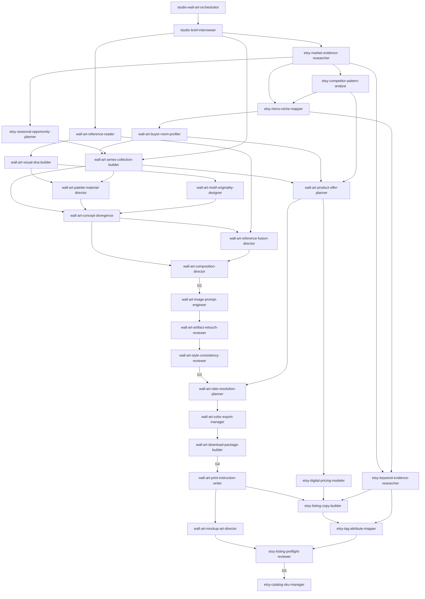
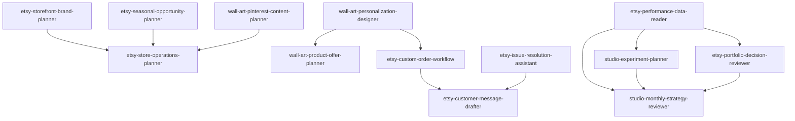

# Arsitektur: dari 48 rancangan awal menjadi 45 skill

Sumber kebenaran: `skill-index.json`. Tabel di `INDEKS-SKILL.md` dan peta di skill pengarah dibuat otomatis darinya.

## Hasil evaluasi 48 skill awal

Empat penggabungan dan satu tambahan. Sisanya dipertahankan karena pemicu, masukan, atau keluarannya memang berbeda.

| Perubahan | Alasan |
|---|---|
| `etsy-listing-experiment-designer` masuk ke `studio-experiment-planner` | Proses dan keluarannya sama (hipotesis, satu perubahan, ukuran, faktor pengganggu); yang berbeda hanya objek ujinya. Dua skill akan berebut keputusan "cara mengukur". |
| `wall-art-reference-role-mapper` masuk ke `wall-art-reference-fusion-director` | Peran referensi selalu ditetapkan untuk satu karya dan langsung dipakai sebagai resep sintesis. Memisahkannya hanya menambah satu serah terima. |
| `wall-art-ratio-crop-planner` dan `wall-art-resolution-print-calculator` menjadi `wall-art-ratio-resolution-planner` | Masukan sama (pixel master), keluaran satu tabel yang sama, dan satu tidak pernah dipakai tanpa yang lain. Satu skrip mengerjakan keduanya. |
| `wall-art-collection-expansion-planner` masuk ke `etsy-portfolio-decision-reviewer` | "Kembangkan" adalah salah satu hasil keputusan portofolio dan memakai bukti yang sama. Pembuatan koleksinya sudah dimiliki perancang koleksi. |
| Tambahan: `etsy-policy-fact-checker` | Empat skill (harga, tag, preflight, penanganan masalah) bergantung pada aturan Etsy terkini. Tanpa satu pemilik, masing-masing bisa memakai angka berbeda. |

Yang dipertimbangkan untuk digabung tetapi dipertahankan terpisah:

- Riset bukti pasar, pola pesaing, dan keyword: metode mencatatnya sama, tetapi keluarannya tiga berkas berbeda dengan pemakai berbeda.
- Pesan pelanggan dan penanganan masalah: yang satu memiliki kata-kata, yang lain memiliki keputusan jalur. Digabung, keputusan refund akan tercampur dengan penulisan.
- Perancang personalisasi dan alur pesanan custom: yang satu bekerja sebelum produk dijual, yang lain saat pesanan berjalan.
- Gerbang kualitas (G1-G4) dan preflight listing (G5): preflight punya masukan dan skrip sendiri, dan menyentuh tindakan terbit.

## Tiga peran

| Peran | Jumlah | Aturan |
|---|---|---|
| Pintu masuk | 1 | Mengarahkan ke skill lain. Tidak ada skill yang menyerahkan balik kepadanya. |
| Layanan | 4 | Dipanggil skill lain, mengembalikan hasil, tidak pernah memanggil skill jalur: register hak, memori merek, gerbang kualitas, pemeriksa fakta Etsy. |
| Jalur | 40 | Menerima hasil skill sebelumnya, menyerahkan ke skill berikutnya. |

Tidak ada ketergantungan melingkar. Ini diperiksa otomatis oleh `tools/run_tests.py` atas gabungan hubungan "menyerahkan ke" dan "memakai layanan". Putaran bisnis (data bulan ini memengaruhi koleksi bulan depan) tidak berupa serah terima langsung: tinjauan bulanan menutup putaran dan menulis ke memori, lalu pekerjaan baru dimulai sebagai proyek atau versi baru.

## Alur utama

Operasional dan pertumbuhan:

Layanan yang dipakai di banyak tempat (tidak digambar agar diagram terbaca): `studio-asset-rights-register`, `studio-brand-memory`, `studio-quality-gate`, `etsy-policy-fact-checker`.

## Lima gerbang

| Gerbang | Apa yang dinilai | Pemilik keputusan | Bukti utama |
|---|---|---|---|
| G1 | Brief | `studio-quality-gate` | brief berlabel, tanpa angka karangan |
| G2 | Konsep dan komposisi | `studio-quality-gate` | arah berbeda, peran referensi, pilihan pemilik |
| G3 | Gambar master | `studio-quality-gate` | hak bahan, laporan cacat, cek gaya, pixel |
| G4 | Paket cetak | `studio-quality-gate` | manifest buatan skrip |
| G5 | Listing siap terbit | `etsy-listing-preflight-reviewer` | keluaran `check_listing.py` dan daftar periksa mata |

Prasyarat keras: produksi butuh G3 lulus; listing butuh G4 lulus; terbit butuh G5 lulus dan izin pemilik studio. Status hak `unknown` dan `blocked` tidak bisa ditimpa siapa pun.

## Satu pemilik per keputusan

Tabel lengkap ada di `INDEKS-SKILL.md` bagian "Pemilik tiap keputusan". Uji struktur menolak indeks yang memuat keputusan dengan dua pemilik. Pola yang dipakai:

- Skill **mengusulkan**, pemilik studio **memutuskan**: niche, arah konsep, harga, nama toko, portofolio, prioritas bulan.
- Skill **memutuskan sendiri** hal yang bisa dihitung atau dicek: status hak, lulus gerbang, klaim ukuran cetak, batas tag.
- Tindakan ke luar (terbit, ubah harga, kirim pesan, refund, pakai kredit, jadwalkan pin) selalu menunggu izin pemilik studio.

## Data bersama

- Aturan inti, lima label bukti, struktur folder, skema serah terima, status hak, dan aturan tindakan ke luar ada di `_shared/studio-core.md`, disalin ke `references/studio-core.md` tiap skill supaya tiap skill bisa dipasang sendiri.
- Serah terima berbentuk JSON dengan enam field wajib (`schema`, `skill`, `date`, `project_id`, `version`, `status`) ditambah `next_skill`; sisanya dipakai bila relevan. Diperiksa `validate_handoff.py`.
- Tiap berkas memori punya tepat satu skill pemilik; skill lain hanya membaca dan mengusulkan lewat `decisions`.
- Data pelanggan terpisah di `studio-nangka/pelanggan/` dan dikecualikan dari git.
